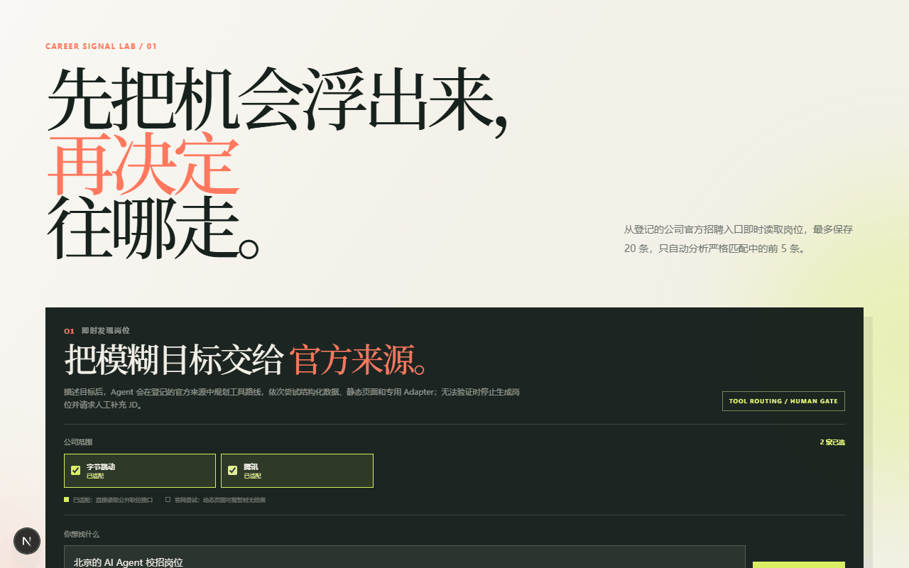
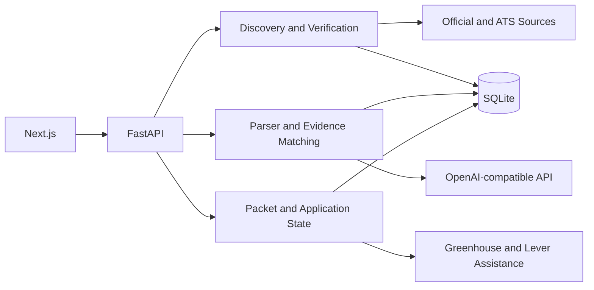
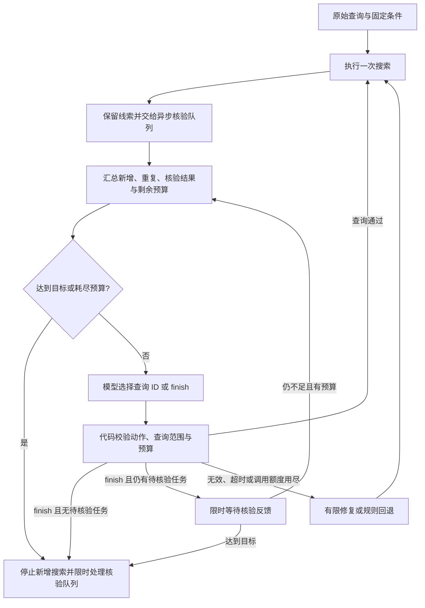

# JobFlow Agent

面向个人校招与实习场景的求职系统。岗位搜索采用 AI 理解与程序执行配合的流程：模型负责搜索策略、列表排序和岗位原文理解，程序负责读取、来源验证、引用校验、预算、缓存和进度保存。完整简历匹配及材料生成仍由用户按需启动。

> 当前版本：`v0.4 Assisted Apply`。支持 SQLite 单机本地运行；不承诺公网多用户
> 托管、任意 ATS 兼容、无人值守批量投递或绕过登录与反自动化控制。



## 核心能力

### 1. 岗位搜索、核验与筛选

当前主流程：保存目标 → 展示可复用岗位 → 官网搜索 / 联网补搜 → AI 列表排序 → 每家公司首轮检查最多3个详情 → AI 统一理解并核对引用 → 即时展示、保存剩余进度。

- `WEB_SEARCH_COMPANY_TARGET` 当前表示每公司每轮详情检查上限；待核实、不符、读取失败同样占用本轮检查次数，不再等待3个严格匹配才轮转。缓存复核单独调度。
- 官网列表生产者完成首批后即可释放；没有有效新增进展时可启动联网补搜，不因曾经发现过一个链接而一直等待核验。Agent 模式也可在当前轮转公司的范围内选择查询。
- 历史复核按标题和已保存正文的相关性排序，同级在公司之间轮换；正常批次保留一个位置处理等待超过一天的岗位。排序只影响检查顺序，最终筛选仍由当前 AI 判断与原文引用决定。
- 已观察并核验的招聘入口与翻页游标分别保存。完成翻页或更改目标后可复用入口，但重新读取筛选项；入口证据最多保留30天，换注册地址立即失效。旧入口或列表接口失效时回到入口重新识别。官网实际出链及目标企业身份共同支持自定义招聘域名，仍不信任仅凭搜索摘要猜出的入口。
- 搜索过程中即可查看岗位；进度请求暂时失败会自动重连，刷新后恢复进行中的任务。公司分组保留剩余线索数量和续查按钮，已有收藏不因更新消失。
- 明确关闭页在模型调用前处理。模型失败时正文和进度保留；无法分区的已读页面标记 `semantic_page_pending`，一天内续查可复用同一用户的快照，不重新访问官网或刷新来源读取时间。
- 同一原文、目标和判断版本复用理解结果；任何一项变化都会使旧判断失效。AI 模式的岗位库、搜索详情和简略历史展示统一采用当前版本，旧规则与旧 AI 结果标记为等待重新理解。AI产品包含在用户确认的目标范围内。
- 列表排序单独并发1、预算 `WEB_SEARCH_SEMANTIC_LISTING_MAX_CALLS=6`。新岗位理解并发 `WEB_SEARCH_SEMANTIC_CONCURRENCY=2`，字段预算 `WEB_SEARCH_SEMANTIC_MAX_CALLS=16`。已有正文的 AI 复核使用独立持久队列，每批6条，自动续接，不再依赖反复搜索。搜索完成后自动排队，也可点击“复核已有正文”；关闭网页不影响后端处理，后端重启后恢复过期租约。已完成但原文缺失的字段不会反复调用模型；三次实际失败后显示为需处理，可手动重试。
- 正文后台批次使用 `WEB_SEARCH_SEMANTIC_CONCURRENCY` 限制并发（默认2），每个任务独立数据库会话并即时保存；取消时等待全部子任务保存检查点。从未完成理解的正文优先于旧结论升级，同组优先相关岗位；每批保留一个最早等待项，已知城市/招聘人群/届别冲突仅降低复核顺序，不跳过。策略升级后，后端启动会重新唤醒有待处理正文的历史已完成队列，保留重试上限。单条意外异常单独冷却并累计失败次数，不暂停其他岗位；已有页面恢复时不额外联网读取关联批次，缺失的批次证据继续待确认，保留原读取时间。
- `source-understanding-v10-broad-role-review` 将方向分为直接相关、相邻、无关、未知及用户明确排除。相邻方向保留“值得看看”；第一次方向排除暂不隐藏，后台用完整原文另做一次反证复核，仅复核方向，不重算已完成字段。无效引用或失败保留原判断与正文，按冷却最多重试3次；新原文或目标变化会使复核结果失效。城市、招聘人群、届别的明确冲突仍可排除。旧版本AI判断仅可用于阅读顺序，不作为当前推荐或排除结论。
- 列表的“搜索条件已确认”只表示搜索条件通过，不等于个人资格通过。学历、院校、论文和经验条款以原文提示；复杂条件仍需完整岗位分析。推广参数链接归为同岗，已有申请及审计记录保留；详情可直接收藏，筛选偏好按用户与搜索条件保存在本机浏览器。
- 有公开结构化列表的官网先在时间允许时汇集最多3个关键词页面，每页10条，再根据标题、城市、招聘性质及职责排序；相近相关性下优先新岗位。HTML 列表尽量携带当前卡片的附加信息。仍只检查3个详情，未检查候选及其各自来源证据保留供续查。排序超时会先发布已读候选。
- 原文明确写“27届校招”时接受为2027届校招；“2027AIDU”等单纯项目年份不能证明届别。正文存在互相矛盾的届别时保留冲突引用。超时后复用保存正文，后续到期重试的模型和 HTTP 超时同步从12秒延长为24秒、最多 `WEB_SEARCH_SEMANTIC_RETRY_TIMEOUT_SECONDS=30` 秒；保留冷却和最多3次实际失败限制。
- `.env.example` 推荐 `WEB_SEARCH_DECISION_MODE=agent`、`WEB_SEARCH_UNDERSTANDING_MODE=ai` 和官网优先。未配置真实模型时仍可运行确定性流程。

真实模型回放（只处理已保存公开官网原文，写入独立数据库副本）：

```bash
python scripts/validate_ai_reading.py --live --database artifacts/source-search-20261018-124315/trial.db
```

2026-10-18 的六条已见结构失败样本恢复6/6：4条优先查看、1条待核实、1条明确不符；6次模型调用约31秒。该结果验证原文理解与保存链路，不代表实时官网覆盖率或独立准确率。旧的规则、方向复核和局部适配说明适用于 `hybrid` 模式；AI模式采用上述统一理解路径。

- 先持久化来源白名单、工具顺序、调用预算和停止条件，再执行搜索；
- 已适配来源优先使用官方 Adapter，失败后按计划回退；
- 搜索支持 `rule` / `agent` 模式：Agent 根据新增链接、重复率与核验反馈选择后续查询；
- 搜索摘要和第三方线索只能创建待验证 `JobLead`，不能直接成为可信岗位；
- 统一执行 URL 安全检查、正文验证、标准化、去重和岗位开放状态审计；
- 有真实模型配置时，默认 `WEB_SEARCH_UNDERSTANDING_MODE=ai`：对详情原文尽量一次完成页面范围识别及城市、招聘类型、届别、方向判断，逐项引用原文；已有完整官网数据则直接进行条件理解，不重复读取页面；
- AI 判断覆盖本地规则的通过或排除；尚未完成理解时保留待核实。程序校验引用归属，不用另一套同义词规则推翻语义结论。`hybrid` 保留历史规则优先兼容模式；
- 对已限定到当前岗位的正文，识别标题与职责之间独立的地点字段，以及“2027届校园招聘计划”等明确届别；带地域、毕业日期或冲突年份的表述仍保留待核实。旧结果刷新时也会从保存原文补取缺失地点，不重复联网或调用模型；
- 地点也支持与标题同行、与招聘项目/职类/人数挤在同一行的页头字段；“查看工作岗位”等导航按钮文字不会当作地点。旧记录仅存有此类按钮文字时，刷新会从原文补取城市，原始记录与证据保留；
- 结果先按“符合已知条件、待核实、明确不符”排列，再在每类内部按公司分组；已通过的公司组默认展开，招聘入口单列在岗位之后；
- 结果分为“符合已知条件 / 待核实 / 明确不符”，仅明确冲突默认收起，缺少原文不等于不符合；
- 两个核验任务并发运行；预算用尽的链接保留为可重试的 `DEFERRED`，不要求用户补贴 JD；
- 核验优先处理标题或摘要与查询方向相关的具体岗位，同等相关性下考虑官网来源。单一来源连续调度最多 3 条后，在有其他来源可处理时让出一次；同时最多展开一个入口，读到的详情链接即时入队。同一 URL 的新官网证据更新排队任务，正在处理的 URL 不会并发重验。以上只改变顺序，不以摘要确认岗位事实；
- 招聘类型取岗位明确字段、标题或头部信息；导航、页脚与推荐岗位不作为当前岗位事实。列表页自动展开寻找详情链接，不计作具体岗位；
- 页面只剩“该职位已下线”时，保存原文、来源 URL 和快照引用为 `CLOSED` 线索，默认隐藏，不补造 JD。超大浏览器页面可移除脚本、样式等负载后核验，仍限制 DOM 和可见文本大小；
- 复杂学历、专业、日期范围及额外条件保留待核实，完整资格与能力匹配由用户按需启动；
- 每次运行保留 Plan、Act、Observe、Fallback 与 Stop 轨迹。
- 公司组先展示 3 条，可展开全部；规则搜索达到数量目标但仍集中于单家公司时，在现有预算内尝试一次未覆盖公司的补搜。达到目标后，剩余核验最多再等待 20 秒，未完成链接保留待核验。
- 已保存目标可选择每 30 / 60 分钟更新，默认关闭。计划保存在数据库；后端运行时关闭页面仍会执行，后端关闭则暂停，下次启动最多补一次。

### 追踪岗位与投递进度

- 顶部「追踪动态 → 岗位追踪」统一查看已保存需求、搜索状态、下一次更新时间，以及最近一轮新增、变更、关闭的岗位。可以选择手动、每 30 分钟或每小时更新；状态读取不会启动搜索。
- 岗位详情可直接「加入申请进度」，无需先进行模型分析。记录从准备中开始；完成官网投递后，手动确认已投递，再登记面试、测评或主动跟进。
- 「追踪动态 → 投递跟进」显示今日与逾期待办。可主动开启桌面提醒：网页保持打开时，定时事项提前 30 分钟、全天事项当天 09:00（任务时区）提醒；同一事项同一时间不会因刷新重复提醒。结束的申请不再进入提醒列表。
- 每条跟进任务可导出 `.ics` 日历，包含时间、下一步动作和提醒。导入日历应用后由该应用通知；任务改期、完成或取消后，需要重新导入更新或在日历中同步处理。这里不自动同步招聘邮件或网站状态。

Windows 本地长期运行（使用现有数据库和 `.env` 配置）：

```powershell
# 在 frontend 中先构建一次；更改代码后重新构建
$env:NEXT_DIST_DIR = '.next-tracking-build'
$env:NEXT_PUBLIC_API_URL = 'http://127.0.0.1:18001'
npm.cmd run build

# 回到项目根目录
powershell -ExecutionPolicy Bypass -File scripts/local-services.ps1 -Action Start
powershell -ExecutionPolicy Bypass -File scripts/local-services.ps1 -Action Status
# 需要停止时：-Action Stop
```

打开 `http://localhost:3000`。启动脚本在后台运行本地前后端，日志保存在 `data/local-runtime/`；停止操作只作用于该脚本记录且身份匹配的进程。关闭网页不影响岗位定时搜索，但电脑休眠、关机或后端退出期间暂停；重新启动后最多补一次到期搜索，不会补跑所有错过的小时。脚本不会安装开机自启动。

### 2. 证据约束的 JD 解析与匹配

- 在岗位详情中按需启动分析，使用 Product Parser；默认先抽取事实和原文条款，再解释条件关系，可配置单次调用；
- 两阶段第一阶段成功后保存检查点，第二阶段失败后的再次分析可以直接恢复关系判断；
- 以 Pydantic Schema、字段级原文证据和一致性检查约束模型输出；
- 匹配结论必须引用当前用户的经历证据 ID，并校验归属与事实一致性；
- 普通能力默认本地匹配；显式启用语义模式后按岗位批量调用，模型引用句子编号，本地回填和校验原句；
- 缺少证据或匹配失败保留为信息不足，不等同于候选人明确不符合；
- 个人届别、学历和专业按类型化规则判断；搜索列表的筛选分类独立于简历匹配结论。
- 支持用户纠正条件原文、强度和关系，补充遗漏或移除误解析项；保存后本地重新匹配，不调用模型。修改按用户保存历史，可恢复模型结果；原始 JD 和共享解析结果保留。

配置、缓存及失败处理见 [JD 执行模式](docs/PRODUCT_JD_EXECUTION_MODES.md) 和
[候选人事实与匹配](docs/CANDIDATE_FACTS_AND_MATCHING.md)。

### 3. 可审核的申请流程

- 简历、答案与投递包使用不可变版本，审批后不允许原地修改；
- Application、Packet、Attempt、Receipt 和 Follow-up 分别记录业务状态；
- 敏感字段需要用户明确确认，ATS 提交授权一次有效且绑定具体任务；
- 遇到登录、CAPTCHA、2FA、页面变化或无法确认的字段时暂停并请求接管；
- 系统核验投递通过有效回执进入 `SUBMITTED`；已自行投递的用户也可明确勾选确认，登记为“用户确认投递”。两者来源分别记录，手动登记不会生成回执或执行提交。

### 4. 简历隐私与数据管理

- 上传仅保存文件。本地提取并隐藏常见个人标识后，展示实际将发送的文字；只有用户核对、勾选确认后才调用解析模型。预览可继续删除内容；自动脱敏不能替代人工核对。
- 可以只保存简历，之后从已有版本的“核对并解析经历”继续。相同确认内容复用解析缓存，切换已解析版本不重复请求模型；新内容仍保留已有人工修正。
- “简历资料 → 账户数据与隐私”提供 ZIP 导出和输入确认文字后删除。导出包含当前用户的记录、纠错、计划和简历文件；删除包括这些数据。

详细行为、升级方式和验收记录见 [功能补齐说明](docs/PRODUCT_COMPLETION_20261016.md)。

## 工作流

```text
求职目标
  -> 来源白名单与 Search Plan
  -> 官方来源 / ATS Adapter / 受控页面读取
  -> JobLead 验证、标准化与去重
  -> 本地按搜索条件筛选，结果陆续显示
  -> 查看 / 保存 / 忽略岗位
  -> 可选：Product JD Parser + 资格规则 + 经历证据匹配
  -> 用户选择并创建 Application
  -> 材料审批与投递包冻结
  -> 人工操作或有限 ATS 辅助
  -> 有效 Receipt 或用户明确登记已投递
  -> SUBMITTED 与后续跟进
```

职责边界：

| 参与方 | 负责内容 |
| --- | --- |
| 模型 / 局部 Agent | 搜索模式启用后根据反馈选择下一条查询；解析 JD、可选语义匹配、生成材料建议 |
| 确定性代码 | Schema 校验、资格规则、URL 安全、预算、状态机、授权与凭证 |
| 用户 | 确认敏感事实、审批材料、决定是否申请和提交 |

## 架构



后端采用模块化单体结构，通过 `api / domain / services / infrastructure` 保持边界；
SQLite 是当前唯一支持的业务数据库。前端以工作区形式覆盖岗位发现、材料库、投递包、
投递尝试、ATS 辅助与后续跟进。

## 评测结果

| 评测 | 数据范围 | 结果 | 适用边界 |
| --- | --- | ---: | --- |
| Staged JD Parser | 基于公开招聘页面构建的 39 条严格子集（规则标签 + 人工覆盖） | Macro-F1 `0.9897` | 仅岗位类型、地点和必备技能三个字段 |
| Core JD Parser v28 | 冻结 dev-21，五字段 | Macro-F1 `0.9549` | 真实 DeepSeek 输出经 v28 确定性归一化重放；开发集，不是最终 holdout |
| Discovery Agent | 13 个离线控制面 Fixture | `13/13` | 来源授权、路由、回退、预算与轨迹 |
| Trusted Discovery | 9 个离线确定性 Fixture | `9/9` | 正文验证、去重、开放状态与人工接管 |
| Assisted Apply | 14 个 Greenhouse/Lever Mock ATS 场景 | `14/14` | 字段映射、接管、授权与提交凭证 |
| 浏览器回归 | Chromium 桌面端与移动端 | `20/20` | 关键本地用户流程 |

Parser 的 39 条岗位原文因来源授权边界未提交到仓库，公开内容包括评测代码、标签覆盖、
指标定义和聚合结果，因此该结果不是可从仓库独立还原原始数据的公共 Benchmark。
Fixture 通过率也不代表真实官网召回率、真实 ATS 兼容率或线上投递成功率。

另有一份 [165 条 AI 校招与实习岗位元数据目录](datasets/AI_CAMPUS_DATASET_2026_08_31.md)，
覆盖 25 家公司；其中 154 条已完成人工字段覆盖。当前已在固定的 21 条开发集上完成
真实模型输出评测；密封 holdout 仍未运行。dev-21 结果用于冻结实现和调试，不能当作
最终测试集成绩。版本与复现实验边界见
[v28 dev-21 冻结说明](datasets/AI_CAMPUS_CORE_V28_DEV21_FREEZE_2026_09_02.md)。

详细口径与机器可读结果：

- [JD Parser 评测](docs/EVALUATION.md)
- [Discovery Agent 控制面评测](docs/DISCOVERY_AGENT_EVALUATION.md)
- [可信岗位发现评测](docs/TRUSTED_DISCOVERY_EVALUATION.md)
- [Assisted Apply 评测](docs/evaluation/m19-assisted-apply-summary.md)

## 快速开始

环境要求：

- Python 3.12；
- [uv](https://docs.astral.sh/uv/)；
- Node.js 22 与 npm；
- Windows PowerShell，或分别启动前后端。

默认配置使用 Fake Model Provider，不需要 API Key 即可运行本地界面和测试。

### Windows 一键启动

```powershell
Copy-Item .env.example .env
powershell -ExecutionPolicy Bypass -File scripts/start-dev.ps1
```

打开 `http://localhost:3000`。后端默认运行在 `http://127.0.0.1:18001`。

### 可选：浏览器能力

基础界面和 Fake Model 演示不依赖浏览器组件。使用动态岗位页面读取或 ATS
浏览器辅助时，在项目根目录安装 Python Playwright 对应的 Chromium：

```powershell
uv run playwright install chromium
```

运行前端 Playwright E2E 时，另行安装 Node.js Playwright 对应的 Chromium：

```powershell
Set-Location frontend
npx playwright install chromium
```

### 分别启动

后端：

```powershell
Copy-Item .env.example .env
uv sync --frozen
uv run alembic upgrade head
uv run uvicorn src.main:app --reload --host 127.0.0.1 --port 18001
```

前端：

```powershell
Set-Location frontend
Copy-Item .env.example .env.local
npm ci
npm run dev
```

接入 OpenAI-compatible 模型时，在 `.env` 中配置：

```dotenv
STRUCTURED_MODEL_PROVIDER=openai_compatible
LLM_BASE_URL=https://your-provider.example/v1
LLM_API_KEY=your-api-key
LLM_MODEL=your-model
```

服务商支持 Responses 内置 `web_search` 时，设置 `WEB_SEARCH_PROVIDER=responses`。
搜索复用上述模型配置，请求 `/responses`，无需 Tavily 密钥。该模式将原始条件、方向与城市、公司官网和同义岗位拆成独立查询；重复或空结果会优先切换查询策略。
默认最多 6 条查询、搜索预算 300 秒；搜索生产队列与正文核验消费队列独立推进，搜索结束后最多继续核验 180 秒，每个页面任务最多 60 秒。
配置项为 `WEB_SEARCH_MAX_ROUNDS`、`WEB_SEARCH_BUDGET_SECONDS`、`WEB_SEARCH_VERIFICATION_BUDGET_SECONDS`、`WEB_SEARCH_VERIFICATION_ITEM_SECONDS`；有效候选目标由 `WEB_SEARCH_TARGET_JOBS` 控制。单次搜索独立限制为 60 秒（`WEB_SEARCH_REQUEST_TIMEOUT_SECONDS`），连接超时及 408/429/500/502/503/504/524 等临时故障在整次搜索内最多重试 1 次（`WEB_SEARCH_TRANSIENT_RETRIES`）；每次重试均消耗一个搜索轮次，401/403 等认证或访问错误停止新增搜索，总预算耗尽则取消请求。单请求超时不会被误当成整次搜索预算耗尽；失败、无具体岗位或核验无有效结果时，规则补搜优先尝试保留原始条件的跨公司查询或同义方向。
招聘入口默认最多展开 8 个，每个最多 6 页、接收 20 条具体链接（`WEB_SEARCH_ENTRY_LIMIT`、`WEB_SEARCH_ENTRY_MAX_PAGES`、`WEB_SEARCH_ENTRY_MAX_DETAILS`）。先按查询相关性排序，再在入队和创建线索前执行限额；跨页共享限额，未接收的已读链接仍保留在页面快照，数量记入轨迹，不视为已判定不符。未确认官网归属的聚合入口保留一条待补搜线索，不批量展开或直接要求用户接管。支持观察到的列表链接、下一页链接及明确的下一页/加载更多按钮；登录、验证码和申请操作不会自动执行。

入口探索另设总计 45 秒、单入口 15 秒的预算，且不超过整轮预算的三分之一（`WEB_SEARCH_ENTRY_BUDGET_SECONDS`、`WEB_SEARCH_ENTRY_ITEM_SECONDS`）；同一来源连续两次展开没有新链接时，本轮暂停入口探索（`WEB_SEARCH_ENTRY_EMPTY_LIMIT`）。具体岗位仍由原核验队列处理。按实际最终 URL、已观察到的岗位内容与链接去重，不猜测或删除未知查询参数；相同 JavaScript 外壳不能证明列表相同。未遍历页面、限额外已观察链接和已处理链接按用户、目标版本保存，次轮先消费剩余链接，再继续页面。入口记录最多保留 100 条，超过一天的旧记录重新探索；无产出完成页冷却 15 分钟，中断且无产出冷却 60 秒。动态按钮页中断时允许重新打开当前页，但已交付链接去重。
搜索结果先合并链接元数据，再把论坛帖子、附件、新闻文章和无关参考来源留在搜索证据中，不作为岗位候选；标题明确指向其他届别的招聘公告也不进入本届候选。缺失届别或 URL 中含旧年份不作为排除依据。相同岗位的跟踪参数变体合并，保留原始响应和链接，保留 `#/job/...` 等 SPA 路由及岗位、项目、企业标识。
Responses 每次请求只要求一次小范围检索、最多 5 条简短结果，输出预算为 1200 tokens；这是请求目标，不保证服务商只执行一次工具调用。完整返回的 sources 保留出处和用途。岗位检索要求模型逐条标记相关、相邻、不符示例、入口或参考；程序首轮最多升级5个候选，其余及参考来源持久化待续查，不与相关岗位同等消耗详情预算。规则补搜在跨公司条件查询、同义方向和具体公司范围之间切换，避免连续执行语义近似的宽查询或只沿固定公司列表搜索。

支持的企业 ATS 链接可自动追溯注册公司官网。公司名称只用于选择待检查官网，必须实际读取到官网出链才确认归属，并保存页面快照和企业范围；不能把共享 ATS 域名整体视为某公司的官网。追溯在单次搜索内缓存，每家公司最多读取 3 页、25 秒，总计最多 4 家；失败时保留待核实状态。

岗位核验支持关联招聘批次：只读取当前岗位正文内唯一且明确标注的批次/项目/公告链接，要求同一官网及同一 ATS 企业范围；OPPO 校招通过公开岗位接口中的岗位 ID、标题、项目 ID 与官方批次列表交叉核对。每次补充最多两次读取、总计 8 秒，失败不影响已读取的岗位正文。批次证据单独保存在 `recruitment_context`，保留来源快照、核验时间和完整招聘对象条件，不拼入原始 JD。缺失届别可由明确批次条件补充；年份冲突、地域及毕业时间附加条件保留待核实，证据超过 7 天不继续用于补充匹配。

通用证据解析支持岗位作用域内的 `dl/dt/dd`、两列表格及标签/值字段组，读取状态、招聘对象与批次关联；批次链接文字可以只是项目名称，关联依据来自其明确字段标签。标准 `JobPosting` JSON-LD 在当前岗位 URL 与标题均一致时可补充文字资格条件及 `validThrough`，保存来源快照，保留地域和毕业日期限制；复杂结构无法完整解释时不截取其中的届别作为通过依据。截止日期已过可确认关闭，未来截止日期、申请按钮及未知数字状态都不能确认在招；缓存期内仍重新检查截止日期。原有公司模板作为额外证据来源保留。

阿里校招模板读取页面实际返回的 `/position/detail` 响应，交叉核对请求岗位 ID、返回 ID 和当前正文标题；保存批次及毕业起止日期，只有岗位响应明确 `status=recruit` 且当前岗位区域展示对应在招业务时确认开放。百度普通校招从当前页面的 JSON 初始数据关联岗位 ID、招聘类型和普通校招项目；不使用页面中的其他岗位卡片、实习公告或特殊人才项目来补条件，`isValid` 也不直接解释为在招。只有“2027校园招聘”栏目名时仍待核实；正文另有同年份的明确毕业生要求时，栏目名不再干扰届别判断。

已保存岗位的复核按公司分批，每轮最多 8 个、每家公司最多 3 个：优先恢复正文可复用、此前因预算或中断未完成的字段理解，再处理其他可复用正文，最后重读过期来源；各组按原排队时间轮转。单公司“继续查找”先限定公司再取名额，用户忽略的岗位不占批次。未知开放状态的官网正文一天内也可复用，保留未知状态与原核验时间；过期证据重新读取。没有足够信息的岗位继续保留待核实，不降低匹配标准。

开放状态核验与“检查开放状态”使用同一规则：岗位页明确的在招/关闭状态可作为证据；关联批次明确开放时，还需当前岗位存在未禁用的申请入口。页面可读、单独的投递按钮、列表中存在某个批次或未解释的接口状态码，都不能单独证明可投递。明确关闭或网申截止优先；重新读到正文不会刷新旧的在招结论。岗位详情页展示关联批次和来源。当前 OPPO 的 `positionStatus=0` 尚无已核实的公开语义，因此仅确认批次，开放状态仍为 `UNKNOWN`；这不代表岗位已关闭。

可选官网直搜：设置 `WEB_SEARCH_DIRECT_SOURCES_ENABLED=true` 后，对明确的校招或实习查询，在本批已核验官网上探测列表读取能力，不再按公司 ID 白名单分流。普通 HTML 优先 HTTP 读取，网页壳再用浏览器；当前页面实际返回符合协议的筛选配置时，使用共用的飞书 ATS 列表读取器。以下关键词、筛选 ID 和接口分页规则适用于该协议：企业 ATS 入口必须由当前注册官网的实际出链确认，保存出链所在页面的真实 URL 与快照；地点和招聘项目 ID 从当前列表配置读取，实习项目按当前名称或项目组识别，不硬编码 ID。按查询中的正向岗位词检索，每家公司最多 3 个词，每页 10 条，同时最多处理四家不同公司官网（`WEB_SEARCH_COMPANY_CONCURRENCY`，可设为 1 至 4）；同一公司共享首轮详情检查上限。同页内优先检查相关岗位；每家公司默认检查 3 个详情就暂停（`WEB_SEARCH_COMPANY_TARGET`），待核实、明确不符和读取失败均计入本轮次数。每家公司另有 30 秒预算（`WEB_SEARCH_COMPANY_SECONDS`）和 `WEB_SEARCH_ENTRY_MAX_DETAILS` 核验预算；每次最多读取两轮关键词页面。已保存目标会保留页码、关键词、同页剩余岗位和核验进度；“继续查找”从断点再检查最多 3 个岗位，可以进入第三页及以后。游标绑定用户和目标条件版本，7 天后需更新搜索；普通“更新岗位”从当前官网重新开始。未查完、当前关键词查完、访问失败与未检查分别展示，不保证覆盖全站。页面自己发出的同源公开招聘响应必须与本次关键词、地点、项目及分页 offset/limit 一致，详情 URL 也必须出现在实际列表链接中；完整职责与要求可直接进入核验，不再逐条打开详情页。保存官网归属证据和完整岗位响应快照，缺失正文仍走原页面核验。补搜优先访问未覆盖的公司，已有符合结果后连续两轮未增加符合岗位则停止新增搜索，已有核验队列仍会处理。

通用 HTML 列表读取不依赖公司名称或专属域名：沿实际可见的招聘入口和唯一下一页链接读取，每次最多 3 页，保留待访问页面、同页剩余岗位和已核验链接；校招/实习入口按当前目标优先排序。隐藏、禁用、推荐区域及跨企业租户链接不进入岗位队列。列表标题只用于核验顺序，具体岗位仍须读取详情和保存原始列表证据；默认 3 次详情检查上限与原接口读取共用。动态列表可读取可见职位卡片实际跳转后的地址，支持同页跳转、新标签页、唯一下一页/加载更多按钮和有明确当前页的数字分页，不执行投递或登录。续查保存页内容指纹、分页路径和卡片偏移，最多回放 20 页；页面顺序变化时从入口重新扫描并按已核验链接去重。分页循环、多义分页、未知交互或读取失败仍保持未完成，并允许官网限定补搜，不把无链接解释为已查全。未收录公司的同结构页面也复用该能力；来源获准尝试不等于已证明可读。

通用站内搜索识别唯一、可见、语义明确的职位关键词输入框及搜索按钮，支持公开 GET 表单和由该控件触发的 AJAX 搜索。只有岗位行或明确空结果发生变化才确认筛选生效；仅输入框变化不算成功，未确认时恢复原列表继续探索。不会提交含个人资料字段的表单、多义控件或原生 POST 表单。每个方向及其别名独立查询，最多 6 个词，保留一次未筛选列表探索；城市、招聘类型和届别仍按详情证据核验。关键词、控件描述、分页指纹和卡片偏移一起保存；AJAX 筛选在返回列表时丢失，会重新执行搜索和分页路径并核对指纹。当前目标内成功的搜索方式可在旧页码过期或查完后复用，最长保留 30 天，每次仍核对当前控件，目标版本变化时重新识别。

浏览器与 HTTP 读取共用 `URL_FETCH_PROXY_ALLOW_UNLISTED_HOSTS` 的配置语义（默认关闭），避免配置代理后官网脚本仍因两条读取路径设置不一致而无法加载；本机、内网字面地址、内部域名和异常端口仍被拒绝。动态读取支持岗位卡片中的普通标题、带职位数量的入口和招聘区块内的“了解更多”，跳过当前已选导航。官方 HTTP 跳转只有在记录完整跳转链、目标为企业专属招聘系统且页面明确提及该企业时才继续；可见招聘控件产生的跨站导航保留原页面和点击观察，后续仍核验企业归属。页面外壳、明确空列表与实际列表末尾分别记录为 `listing_not_ready`、`listing_empty`、`listing_boundary`，不把未加载成功当作已查完。

列表排序优先岗位方向，其次招聘类型，避免所有带“校招”的标题挤占前面的读取名额。未知标题保留在后续队列，排序不代替岗位资格判断。官网域名上的内推邀请、登录及投递操作页作为非岗位来源保留在搜索证据中，不进入岗位读取队列；真实详情链接携带内推参数仍可核验。

正文核验队列也使用方向和招聘类型排序；公司轮换只在同等优先级之间进行。后续搜索补充了更相关的标题时，可提升尚未开始核验的同一链接，同时保留已有官方入口证据，不重复读取已经完成的岗位。社区帖子、资讯及帮助主题页保留为参考来源；旧记录再次出现时也不会展开为招聘入口或触发正文、截图读取。

已保存目标的官网直读和网络补搜可以并行：某家公司失败后立即允许补搜，开始读取或最近一次产生新候选后最多 8 秒（不超过公司预算的一半）没有新进展时允许补搜，不必等待详情核验或整批官网结束；排队等待的公司不消耗该延迟。两条路径共享总时间预算、去重和每家公司首轮三次详情检查上限；已读取的相同 URL 复用结果，失败链接新增官方证据时仍可再次核验。补搜查询游标与官网分页分别保存，取消或耗尽预算时保留未完成进度。

官网入口读取支持同域默认端口的 HTTP/HTTPS 跳转，沿页面实际链接进入企业招聘门户；自有招聘域名需核对品牌标题，共享 ATS 始终限制到原企业租户。飞书兼容协议的自定义路径从可见详情链接推导，不依赖固定的校园路径名称。没有普通岗位链接时，可操作明确的“查看职位”等列表入口按钮，按校招/实习上下文筛选；这些按钮只用于导航，不能作为岗位、职责或开放状态证据。动态卡片兼容常见的 `job/position/pos` 类名，详情地址仍从真实跳转取得。

通用详情提取器 `generic-job-scope-v5` 支持招聘组件内的短标题类名和语义标题。“工作城市”“招聘对象”等字段标题不再被误认成第二个岗位名；通用详情容器与站点导航分开取证。标题中的嵌套热招标签、职位类别等字段单独保留在正文证据中；悬浮栏与正文重复显示同一个岗位名时，按关联职责区域消歧。相同名称的两个独立岗位正文仍拒绝合并，招聘组件外围的资格要求、关闭状态、隐藏区和推荐区保持各自边界。已可靠解析的正文优先于网站浏览器标题和截图识别；热招标签、申请按钮仍不能单独确认在招。旧记录因结构解析失败而暂停时，只有新版提取器能解析同一用户、同一岗位链接的原始快照，才允许下一轮重新读取一次官网；不会直接用旧快照确认为新核验，也不会解除验证码、登录、来源确认或用户忽略状态。

页面类型区分搜索生成的标题与实际观察到的官网卡片标题：生成的职位名称不能将项目页、专题页直接升级为岗位；实际卡片的标题依据会随线索保存，供展示、核验调度和失败续查使用，仍须详情证据才能成为正式岗位。只有一两个脚本的页面，若声明脚本并保留空的应用挂载节点，也会进入浏览器补读，不因脚本数量少而直接判成非岗位。职责判断统一 Agent/AI Agent/智能体等别名，识别产品功能开发、编排方案、协作组件等实际实现对象，保留原文引证；编写开发文档、使用指南，或技能偏好、数据运营、研究背景中的关键词不单独证明应用研发职责。相同来源、正文和查询的 v20/v21 职责缓存可用 v22 规则重新检查原始模型提案，历史证据不被改写。

已保存目标按公司分批查询，默认每轮最多 6 家（`WEB_SEARCH_COMPANY_BATCH_SIZE`，同时受搜索轮数预算限制），优先尚未尝试的公司，然后轮换上次查询较早的公司。手动搜索和定时更新复用数据库中的进度，重启不会从名单开头重复开始。支持官网列表的公司沿用未过期的分页进度；其他公司执行保留全部目标条件的官网限定补搜，并保存查询策略进度。补搜成功或没有结果都只表示本次查询结束，不能宣称官网已查完。修改目标后进度按新版本重新计算，岗位记录保留。

直搜还支持 Unity 中国等已登记的飞书招聘自有域名，以及通过官网证据链入库的企业飞书租户，复用同一个列表读取器。校园入口必须来自当前官网实际链接或已核验的校园入口；同时支持页面实际发出的 GET 和 POST 列表请求。仍逐项核对城市、项目、关键词、页码及可见详情链接，不能将共享 ATS 主站或相邻租户当成同一公司。官网返回的项目名称可以补招聘类型，但不能仅凭 URL 或一个年份确认届别。

网页搜索的 `usage_metrics` 持续保存真实使用指标，搜索历史直接展示：从创建任务到首次核验结果/首次符合岗位的时间（包含缓存），以及本轮新读正文后首次符合的时间；实际尝试读取的具体岗位 URL 数及完成正文核验数；缓存复用数；带有此前失败记录、这次确实重新读成功的正文续查恢复数；新入库且符合的岗位数，以及已有岗位从不符合/待核实转为符合的数量。另按公司统计官网列表读取尝试数、成功数和失败续查恢复数；成功表示新读到可用列表或已验证协议的列表响应，不代表岗位已符合目标或全站已查完。仅消费上轮列表缓冲不计本轮官网读取。正文读取率按岗位 URL 去重，不是 HTTP 请求成功率或全站覆盖率；同一 URL 的 HTTP→浏览器回退仅计一次尝试。缓存和尚未开始读取的预算暂缓不计入读取分母；没有读取时成功率为空，不能显示为 100%。重复返回和后续方向复核不重复增加有效岗位；旧运行不倒推测量数据。启用前执行 `alembic upgrade head`（迁移 `0031_search_run_metrics`）。

“官网查询进度”展示总公司数、已尝试和待查询数量。“继续扩大搜索”执行下一批，“继续查找”只查询所选公司；普通补搜与实际官网分页分别展示次数和页数。导航和页脚中的招聘入口参与发现，失败入口保存原因和冷却时间后移到队尾，继续其他入口；有效岗位分页优先续接，仍遵守每公司先读 3 条详情的上限。企业身份允许可信原始官网域名中的英文品牌和保守的中文企业后缀变化，跨域出链、跳转证据及 ATS 租户边界继续独立校验。

新公司发现独立于前台岗位搜索，在后端持续运行时自动续接。未限定公司的已保存目标会在搜索时入队，也可点击“发现更多公司”。按最多 3 个方向拆分查询（例如 Agent、RAG、AI 产品），不将毕业年份用作公司发现的硬条件。每次搜索单独等待最多 60 秒（`COMPANY_DISCOVERY_REQUEST_TIMEOUT_SECONDS`）；失败后去除城市等修饰，重试更聚焦的方向查询一次。搜索原始线索、模型提取的公司、官网核验结果分阶段落库，重启后从未完成阶段恢复；前台搜索结束不会取消发现。模型提取最多重试 3 次，公司核验按已有冷却间隔最多尝试 3 次，保留证据缓存。队列使用租约防止重复执行，目标版本变化会使旧任务失效。fake 模型配置下停用自动发现。

支持的 Responses 搜索提供方收到真正的 `max_tool_calls` 参数（默认 `COMPANY_DISCOVERY_TOOL_CALLS=1`），同时记录实际工具调用数和查询词。明确拒绝该参数的兼容服务会回退，并记录 `unsupported`；返回调用数超过限制则记录 `exceeded`，不声称提示词能强制限制服务端搜索。当前实现使用有界响应和阶段持久化，尚未接入流式搜索结果；不支持调用次数限制的提供方依靠独立超时与小查询控制等待，超时前尚未返回的结果仍无法保存。

核验证据优先选择不同高校、政府或科研网站的企业介绍及招聘公告，百科作为补充。每家公司最多尝试 4 个独立证据页面，同时读取 2 页；普通读取最多 10 秒，识别 HTML 中文编码及 PDF 文字、URI 链接注释。PDF 仍受现有响应大小限制，最多 30 页，无文字或超限文档保留待核验。只有可读的 HTML 网页壳或缺少招聘链接时才尝试浏览器补读，每家公司最多 1 页、12 秒；403、404、连接失败和验证码直接记录原因并换来源。保存每次读取的方法、时间、错误码和 HTTP 状态；最多缓存 12 份页面证据，有效期 7 天，失败 URL 冷却 1 小时，失败站点 24 小时内降低优先级。补证 URL 与成功页面逐步入库，取消后可续接；缓存保留原读取时间，不会伪装成刚刚核验。

搜索候选先保存到用户私有公司表，只有读到公司主页品牌、独立高校/政府/百科页面提供的官网归属证据，以及经过核验的官网与招聘入口关联路径，才自动纳入后续批次。支持沿产品主页、公司介绍和招聘页面的真实链接追踪当前入口，最多读取 4 个关联页面、经过 3 条链接；旧招聘地址失效时可替换为路径中实际发现的新入口，保留原地址和完整路径。独立来源可帮助定位不同的公司主域名，跨域关联页仍须有品牌标题，或品牌正文及回指已核实主页的链接。搜索摘要、模型判断和 PDF 中没有实际链接的文字网址不能代替此证据链。Moka 等共享平台限定到租户路径，不能信任整个平台或接受跨租户跳转。无法读取、缺少独立证据或路径不完整时保留为待核实，后续普通搜索按退避间隔重试；不会因此丢失岗位结果。固定公司搜索和单公司续查不扩展公司范围。

官网归属核验使用 `company-official-evidence-v3`：独立 HTML 原文明确标注“公司官网 / 官方网站”的完整网址也可作为声明证据；明确声明官网域名时，只选择其他已读取页面实际出现过的根网址。保存原句及 `hyperlink / labeled_text_url / explicit_domain` 类型，不将文字声明伪装成超链接。组合品牌名允许其中明确的中英文名称匹配，通用词不能单独证明身份。同一已核实主域名下的招聘子域，若有企业品牌、招聘正文以及实际回指主站的链接，也可核验；界面如实显示回链方向。普通裸网址、否定声明、跨公司正文及无链接注释的 PDF 文字仍不能建立官网归属。

动态列表支持带职责或地点信息的通用 CSS 卡片、无表单的职位搜索输入框、单条筛选结果和明确空结果；仍通过真实点击取得详情地址。飞书列表保留已观察到的 `/position/list` 路径，介绍页不再冒充列表。官网直接链接到 ATS 岗位时保存原始出链页，仅放行具体岗位链接；ATS 租户不能借此引入其他租户。图片式链接以及带 `/apply/<租户>/…#/jobs` 的公开 ATS 列表可作为入口，普通申请地址不属于列表。导航的校招/社招文字冲突只影响读取顺序，不决定岗位招聘类型；最终仍逐条读取详情判断。

页面“新公司发现”展示核验状态、原因、证据链接和成功的入口路径，没有保存目标时也可查看。待核实公司提供“确认或修改入口”：用户查看并填写公司主页及招聘入口，明确勾选归属确认后，保存为 `manually_confirmed`，标注“人工确认 · 已加入公司库”；自动核验仍使用 `verified`。两者都会进入后续分批查询，岗位条件仍须逐条核验。保留确认人、时间、原地址和原自动核验失败原因，人工确认不会生成虚假的官网出链证据，也不能绕过公开网址安全检查或扩大共享 ATS 的租户范围。后台核验更新期间保留正在编辑的地址，过期确认请求拒绝覆盖新记录；自动核验不能覆盖已人工确认的记录。接口为 `GET /api/discovery/companies` 与 `POST /api/discovery/companies/{company_id}/confirm`，提交需要 `homepage_url`、`career_url`、布尔值 `confirmed: true` 和列表返回的 `expected_revision`（对应 `review_revision`）。

已通过的公司出现在“官网查询进度”。新增来源属于当前用户，纳入账户导出和删除。数据库升级使用 `alembic upgrade head`（后台公司发现新增 `0033_company_discovery_queue` 迁移）。轮询回归使用固定搜索响应，证明调度和进度恢复行为，不代表所有官网的实时可读性或岗位召回率。

列表每组先显示 3 条，点击“显示更多已有岗位”每次增加 10 条；此动作不发起官网查询。搜索期间只轮询当前运行的精简结果，结果变化时同步本轮岗位与线索；历史记录分页读取，完整搜索过程按需加载。升级已有数据库请先备份，再运行 `uv run alembic upgrade head`（新增公司查询进度字段）。

岗位展示增加独立的 `review_status`：正文已核验、主要搜索条件通过，仅缺届别或开放状态时列入“优先查看”，明确标注“届别待确认 / 开放状态未知（或待更新）”。复杂届别条款尚未理解、地点/方向/招聘类型或其他必需条件不明时仍待核实；明确不符或关闭默认隐藏。AI 产品岗位按用户目标保留，不当作研发职责。“全部条件已确认”仍使用严格的 `filter_status=matched`，仅指搜索条件与开放状态；每公司首轮最多核验 3 条详情，待核实、不符和失败都占读取名额，剩余候选保留续查。岗位库同时返回 `recommended`、`needs_review` 和原有严格筛选计数，后两种待核实口径不能混加。运行指标 v4 分别记录首次优先查看（含缓存/本轮新读）、首个新入库推荐岗位耗时 `first_new_recommended_ms`、新增优先查看和已有岗位转优先查看；原有严格指标继续保留。旧运行没有新指标时不补造数据；不需要数据库迁移。

找回率审计会记录有界的候选 URL、排序、排序失败兜底及详情交接，不用旧岗位刷新冒充新发现。公司入口尚未读出有效列表时，补搜保留公司和求职条件但不锁死入口域名；已观察到实际列表则按该列表补搜，共享 ATS 始终保留租户范围。`AI Agent` 在站内检索时用 `agent` 扩大召回，保存的目标条件不变。排序失败时利用岗位卡片或 ATS 职责文本，并在同等检索相关性下优先新岗位。2026-10-19 的六公司隔离对照在 `artifacts/retrieval-audit-20261019/report.html`；21 条由助手核对的官网样本不代表全网岗位，运行前固定标签、每次运行原文和续查结果均保留。

固定验收使用 `datasets/real_job_understanding_acceptance_20261018.json` 的 11 条真实官网原文与 `datasets/real_job_understanding_recorded_v3_20261018.json` 的真实模型记录；旧版记录单独保留。运行 `python scripts/evaluate_job_review_acceptance.py` 可离线复核原文哈希、证据引用、44 个字段和展示判断，生成 JSON/HTML 报告；样本由助手审计、用户确认目标范围，不是独立人工金标。附加 `--run-report artifacts/<实搜目录>/report.json --database artifacts/<实搜目录>/trial.db` 可只读核对该轮找回情况，区分“读到正文 / 仅有线索 / 未找到”和“展示判断不符”。默认离线回放不测试实时联网、全网覆盖率或新的模型输出。

官网直搜与核验通过持久化候选队列衔接：每家公司首轮最多交接 3 条候选，完成交接后即可结束列表任务，后续核验通过独立回执更新进度。候选及其原始列表证据保存后即可继续发现下一条；已处理与待处理分别记录，翻页或中断不会丢失在途岗位。续查优先恢复这些候选，保留原证据读取时间；旧游标仍可使用，无需新增数据库迁移。官网直搜与网络补搜共用每家公司默认 3 次详情检查预算；不依赖最终符合数量。超出本轮预算的候选持久化待续查。

每家公司的读取预算只统计列表读取和推进；等待读取名额、等待核验分别计时。核验等待受 `WEB_SEARCH_VERIFICATION_BUDGET_SECONDS` 约束，所有任务仍受整轮搜索总时限约束。等待核验时释放官网读取名额，其他公司可以继续；历史待处理候选在本轮开始时入队。未完成核验记为可续查的 `verification_pending`，不再误报列表响应格式错误，网络补搜仍可接手。轨迹增加实际读取时间和核验等待时间，并保留公司总耗时、排队时间、暂停原因与结果数量。未支持的企业、查询和招聘类型继续走原流程。开关默认关闭，设为 `false` 可关闭试点。每次搜索复用一个浏览器进程，各页面仍使用独立 context，搜索结束或取消时清理。

判断边界：招聘类型标签与明确实习职责或时长冲突时保留待核实；过去的实习经历不改变当前招聘类型。排除前端时，必须承担前后端工作的全栈岗位会排除，方向可选或职责不完整时保留待核实。仅搜 Agent/RAG 时，团队介绍中的关键词不足以通过；项目符号列出的职责单独读取。模型排除结论与直接目标研发职责冲突时降为待核实，模型通过也须有对应职责证据。上述判断只筛岗位条件，不判断候选人资格。

原文语义兜底：正文已取得但通用结构识别失败时，HTTP 与浏览器核验均可基于完整段落识别唯一岗位、职责与要求；不能确认唯一岗位则仍保留线索。正式搜索先用规则判断，再对待核实的地点、招聘类型、届别和方向调用原文复核，引用完整段落，保留限定条件；不再用同一套关键词白名单否决经过引用校验的新语义结果。结果绑定正文、来源、元数据、搜索条件和版本，保存后刷新可复用。原文缺失、语义歧义与尚未提取分别记录；没有届别证据不会推断年份，开放状态沿用独立判断。产品岗位仅在用户目标包含产品方向时按对应职责匹配，不当作研发经历。

字段续查覆盖地点、招聘类型、届别与方向。开放状态未知但一天内已核验的官方正文也可复用，保持原核验时间和未知状态；超过一天重新读取，明确在招正文沿用七天缓存，已关闭、过期或非官方正文不走该缓存。岗位进入异步理解队列时即保存未完成字段、排队时间，模型完成、失败或取消时更新状态；预算不足或取消不消耗失败重试次数。失败调用按同一正文与条件冷却 60/300 秒，三次失败暂停自动语义重试，正文、条件或理解版本变化后重置。已完成的歧义判断或原文缺失不重复调用模型。相同官网正文再次读取时保留理解结果，正文、地点、招聘类型或关联证据改变时重新判断。缓存理解不受官网网络读取的熔断或并发名额阻塞。对应回归用例：`tests/test_search_continuation.py`、`tests/test_semantic_resume.py`。

语义版本 v3 整体理解研发责任、交付系统与目标技术之间的关系：职责明确设计开发 AI 应用系统，并将 Agent/RAG 作为该系统的实现或落地技术时，不因“探索”一词降为不明；独立的技术探索、工具使用和其他通用研发责任不能自行拼接成目标研发证据。必须引用关联这些内容的完整职责。新版会重算旧版已完成判断；v2 尚未处理、且原文与条件未变的预算暂缓/排队/取消记录保留原排队时间。

官网搜索先使用明确控件；遇到陌生标签或多个候选时，模型只能选择实际观察到的公开搜索控件编号。操作前重新检查控件、GET 方法与来源范围，操作后必须观察到岗位结果或空列表变化。搜索方式保存后可续查复用；申请、登录、订阅及个人信息表单不进入模型候选。字段复核使用 `WEB_SEARCH_SEMANTIC_MAX_CALLS`（默认 16）；结构恢复与控件发现另用 `WEB_SEARCH_SEMANTIC_RECOVERY_MAX_CALLS`（默认 4），避免挤占字段理解预算。前台字段与结构恢复共用并发2；列表排序和历史复核各有独立并发1，历史复核默认最多4次。首次单次12秒，已保存的超时任务在冷却后延长至24/30秒，不做隐式重试，仍受整轮搜索预算限制；可用 `WEB_SEARCH_SEMANTIC_ENABLED=false` 关闭。

真实原文验收样本在 `datasets/real_pending_jobs_20261018.json`，包含完整捕获文本、字段标签、审计原因及人工确认范围。`python scripts/evaluate_source_understanding.py --live` 用配置的模型回放，输出字段找回与误确认数；这是公开标注的开发样本，不能当成全网召回率或独立测试准确率。`artifacts/pending-job-audit-20261018.html` 可逐条核对原文。需要隔离的六公司联网试用时，可运行 `python scripts/validate_source_search.py`，该脚本依赖已保存的试用基线数据库，并只修改生成的副本。

实搜后可运行 `python scripts/validate_saved_continuation.py --database artifacts/<实搜目录>/trial.db`：再次复制指定数据库，选择最多 8 条正文仍在缓存期、字段理解尚未完成的岗位调用真实模型，记录字段前后变化与失败状态。该检查不访问招聘页面，不改动输入数据库；它验证缓存续查，不代表全网找回率或独立准确率。

完整续查链路验收使用 `python scripts/validate_semantic_resume.py --database artifacts/<实搜目录>/trial.db --goal-id <已保存目标ID>`：复制数据库后按正常批次选择岗位，使用真实模型运行搜索调度、理解持久化与展示更新，核对搜索记录、当前运行接口和岗位库是否一致，生成 JSON/HTML 报告。该验收关闭新公司发现与官网直搜，网络检索返回空结果，跳过历史入口/线索续查并禁止页面读取；不修改原数据库，也不测量实时官网覆盖率。独立旧方向复核关闭，以单独验证通用字段理解。

方向复核仅发送查询和公开岗位正文，不读取简历。每次搜索最多 12 次、每次最多 15 秒、不自动重试，计入现有核验预算；已有明确地点、招聘类型或方向排除结论、正文不完整时跳过。完整职责明确包含目标系统、应用、工具或前后端服务的设计研发时，由本地保留原文证据并确认，模型预算用于语义不明确的岗位；产品规划、售前、团队愿景、否定句和资源平台关键词不会走此捷径。复核只影响岗位方向，不能覆盖地点、届别等其他条件；非法引用或模型超时不产生排除结论。结果按用户、查询、正文和版本绑定保存，刷新复用，正文或查询变化时失效。可用 `WEB_SEARCH_ROLE_REVIEW_ENABLED=false` 关闭。
方向复核 v16 向模型提供职责段落及编号，模型返回结论、简短原因和最多 3 个引用编号，本地将编号还原为精确原文并校验。并发到达的岗位默认每批最多 2 条（`WEB_SEARCH_ROLE_REVIEW_BATCH_SIZE` 可设为 1 至 3），默认最多 2 个模型请求并发（`WEB_SEARCH_ROLE_REVIEW_CONCURRENCY` 可设为 1 至 3），短暂收集后即发送，不等待凑满；单条沿用原格式，每条输出预算 300 tokens。12 次上限按实际模型请求计数，单项引用校验按岗位隔离；岗位编号与职责编号必须共同匹配，不得借用另一岗位证据。批次用量仅记一次，不按岗位重复累加。章节名需有明确边界，“为符合岗位要求的同学”等正文短语不能截断职责。用户未限定工作占比时，为其他业务系统引入 Agent/RAG 并实现功能也属于实际应用；明确任务或官网前后端岗位名称与模型排除结论冲突时保留待核实，不能直接排除。产品规划、体验设计等交叉职能由模型复核，通过与排除冲突保护均须绑定本人实际开发或实现职责；“设计优化开发框架”等规划表述不足以按研发方向通过。芯片后端、布局布线、RTL、DFT与封装不属于软件后端；完整芯片职责可本地排除，明确承担软件服务开发的混合岗位保留。协同其他前后端团队不足以确认本人开发，“参与后端开发”则按实际职责判断。纯容器网络/CNI、网络协议栈和内核研发引用不能直接证明服务端研发，缺少明确后端服务任务时保留待核实；混合职责中明确开发后端服务仍可通过。窄范围的大模型应用查询需要具体职责证据，泛泛的模型能力提升、服务于 Agent 场景的基础设施、探索结合与提效目标不足以通过；原文明确的研发任务不会因同句后半段出现“熟悉、经验优先”而被抹去。保留完整职责，不重复附上整份 JD；超过模型调用预算时保留本地筛选结果。
方向范围由用户限定：普通后端查询包含平台核心模块、数据服务、资源调度和分布式系统研发，不限业务 CRUD；纯部署运维或模型训练本身不足以通过。用户明确排除基础设施时仍遵守该限制。方向策略升级会使旧版本复核缓存失效，避免继续沿用已修正的排除结论。

动态官网可为每家公司配置已观察到的精确 `resource_hosts`，这些只用于页面资源加载，不建立企业归属。小米的 `jobs.f.mioffice.cn` 与飞书等 ATS 一样，仍须官网出链才能获得企业范围内的信任。

列表读取在配置代理时，还可加载当前页面明确声明、位于已知公共 CDN 基础设施（`*.cdn.bcebos.com`、`*.alicdn.com`、`*.feishucdn.com`）上的 HTTPS 脚本和样式。该权限仅限声明的资源地址与资源类型，不扩展为任意 API、页面导航或企业归属信任。登录、验证码、页面初始化后离开公开网址、未支持的列表结构仍可能阻止读取，失败原因与续查进度会被保留。
搜索历史展示每条查询、实际查询（服务商有返回时）、新增/重复链接、具体岗位数、耗时及失败原因。完整响应与查询证据保存在 `search_evidence`，通过有用户权限校验的 `GET /api/discovery/runs/{run_id}/search-evidence` 获取，并纳入账户导出/删除。
正文核验与方向复核使用独立队列：正文读取和本地筛选完成后立即发布，再由复核消费者更新该岗位的结论与搜索反馈。等待与补搜将两条队列的待处理和执行中任务一起统计；停止前在既有总核验预算内排空，超时保留本地结果或待核实，取消时清理在途模型请求。15 秒模型超时从请求实际发出时计时，排队由核验预算约束。
核验轨迹分别记录排队等待与任务执行耗时，并按官网追溯、入口展开、HTTP 正文核验、浏览器正文核验和方向复核记录阶段耗时。正文核验阶段包含页面读取、本地验证和保存；方向阶段包含缓存查询，不能把每次进入该阶段都当成模型调用。并发任务的耗时不可直接相加作为总耗时。
响应即使未整体完成，只要有已完成的真实联网搜索记录，仍保留可用链接与来源并标记部分结果。摘要不会变成已核验 JD；原始正文核验成功后才进入 JD 解析。兼容网关明确不支持 sources include 参数时只重试一次，并保留拒绝响应。
搜索与核验预算不含随后最多 5 条 JD 分析。达到预算后保留已有线索，不保证岗位数量或全网覆盖。

### 可选：搜索 Agent 决策

默认 `WEB_SEARCH_DECISION_MODE=rule` 保留现有策略。配置好上述真实结构化模型后，
在 `.env` 中启用并重启后端：

```dotenv
WEB_SEARCH_DECISION_MODE=agent
WEB_SEARCH_DECISION_MAX_CALLS=6
WEB_SEARCH_DECISION_TIMEOUT_SECONDS=12
```

决策模式与搜索服务分开配置：Agent 可使用 Responses、Tavily 或 Bing RSS 执行搜索；
模型决策复用 `STRUCTURED_MODEL_PROVIDER` 和 `LLM_*` 配置。默认 Fake Provider
不模拟搜索决策，启用 Agent 但仍使用 Fake Provider 时会因输出不符合契约而回退规则。



第一轮始终使用原始查询。后续轮次提供候选查询 ID、历史查询、新增与重复链接数、
正文核验失败类型、已核验岗位摘要和剩余预算；排队及正在核验的任务单独计数，
不会当作“没有找到岗位”。

第一版允许 `search_web(query_id)` 和 `finish`。候选查询由代码生成，完整保留原始
用户条件，仅追加已登记公司官网范围或已知岗位关键词。模型只能选 ID，不能自由重写
城市、届别、公司范围或输出任意 URL。招聘入口展开仍由现有工作流控制。

每次决策最多修复一次，修复也计入总调用上限；模型请求不自动重试网络错误。
决策与修复共用一次决策的时间额度，最多使用当时剩余搜索时间的一半，并受整个搜索
时间预算约束。模型失败、动作非法或决策调用耗尽时，使用规则选择尚未执行的查询。
`finish` 遇到待核验任务时，先触发一次核验检查：等待不超过 15 秒、单项核验时限和
剩余搜索时间的一半。达标则停止新增搜索；仍不足则提供最新反馈并要求选择新的查询，
再次结束的建议会被拒绝并进入有限修复或规则回退。检查本身不占搜索轮次，等待时间计入
搜索总预算。模型等待期间已达到岗位目标时，工作流会丢弃过时的搜索建议。
全部搜索结束后，未完成线索仍按原核验预算处理。

`agent_trace` 保存观察输入、模型建议、校验错误、选中的查询、简短理由、耗时和
服务商返回的 token 用量；实际执行的查询另存 `search_evidence`。离线测试覆盖选择、
回退、预算、取消与队列处理，尚未测量该模式相较规则策略的真实岗位召回、耗时或成本收益。

真实小规模试跑可使用下列脚本。两个模式都使用同一套保留原始条件的候选查询、相同的
搜索与核验预算，以及最多一秒的核验反馈等待；分别创建新的 SQLite 数据库，默认不执行
后续 JD 分析。目录必须尚不存在，原始响应保存在数据库，指标与轨迹保存在 `report.json`。

```powershell
uv run python -m scripts.run_search_decision_probe --mode agent --output-dir artifacts/search-probe/agent
uv run python -m scripts.run_search_decision_probe --mode rule --output-dir artifacts/search-probe/rule
```

可用 `--query` 指定需求。单次顺序运行只用于诊断，搜索结果会随时间变化；工作流中的
有效岗位数是现有匹配规则的统计，不能替代对届别、方向和开放状态的逐项核实。

`.env`、本地数据库、私密材料和评测原始输出均已排除在版本控制之外。

## 验证

真实官网与无 API Mock 的前后端验收见 [2026-09-17 验收报告与复跑说明](docs/DISCOVERY_ACCEPTANCE_2026_09_17.md)。

```powershell
uv run alembic upgrade head
uv run pytest -q
uv run ruff check .

Set-Location frontend
npm run typecheck
npm run build
npm run test:e2e
```

GitHub Actions 会从空 SQLite 文件执行迁移，并运行后端测试、Ruff、前端类型检查、
生产构建和 Playwright 桌面/移动端回归。

## 项目结构

```text
src/
  api/             FastAPI 路由与请求契约
  domain/          状态机、实体与领域规则
  services/        发现、解析、匹配、材料和投递流程
  infrastructure/  SQLite 与模型客户端
  evaluation/      可重复评测入口和指标
frontend/          Next.js 工作区与 Playwright E2E
migrations/        Alembic SQLite 迁移
datasets/           版本化 Fixture、Manifest 与标签覆盖
docs/               架构、评测和完整技术参考
tests/              后端单元、服务与端到端测试
```

## 安全与范围

- 招聘网页始终按不可信输入处理，页面文字不能覆盖系统约束；
- 网络读取限制协议、主机、重定向、响应大小、超时和重试预算；
- 私密简历保存在非静态目录，日志对密钥、令牌、邮箱和手机号脱敏；
- 本地 `AUTH_MODE=local` 仅用于开发，staging/production 会进行 fail-closed 配置检查；
- 系统不绕过登录、CAPTCHA、Cloudflare、2FA 或其他反自动化控制；
- 无人值守批量投递、任意 ATS 和公网多租户部署不在 `v0.4` 范围内。

## 延伸阅读

- [完整技术参考](docs/TECHNICAL_REFERENCE.md)
- [开发流程与模块边界](docs/DEVELOPMENT_WORKFLOW.md)
- [里程碑与实现记录](docs/IMPLEMENTATION_HISTORY.md)
- [真实模型验收说明](docs/REAL_MODEL_ACCEPTANCE.md)
- [JD 阶段恢复、单次调用模式及对照结果](docs/PRODUCT_JD_EXECUTION_MODES.md)
- [安全策略](SECURITY.md)
- [CI 发布门禁](.github/workflows/ci.yml)

## License

本项目采用 [MIT License](LICENSE)。
# 官网投递进度同步

在“追踪动态 → 投递跟进 → 官网申请进度”添加个人投递页链接，安装本地浏览器辅助组件后点击“一键同步”。当前适配同程校招个人页，读取岗位、招聘类型、地点、投递时间与官网状态，保存变化历史。可手动关联已有申请，关联后的官网变化进入申请时间线；“进行中”等笼统状态不会被推断为笔试或面试，投递时间不会被当作面试时间。

组件安装和访问范围见 [browser-extension/README.md](browser-extension/README.md)。登录由用户在同一个 Chrome/Edge 中完成；不迁移 Codex 内置浏览器登录态，不保存网站密码，不调用模型处理个人申请表格。此版本由按钮触发同步，岗位搜索的每小时计划不等于官网投递进度定时同步。登录失效、读取失败或记录消失均保留之前的有效观察。

更新组件后运行 `python scripts/package_portal_extension.py` 生成网页下载包；数据库迁移为 `0034_portal_tracking`。回归检查：`pytest tests/test_portal_tracking.py tests/test_follow_ups.py`、`node --test browser-extension/test/background.test.js`。
