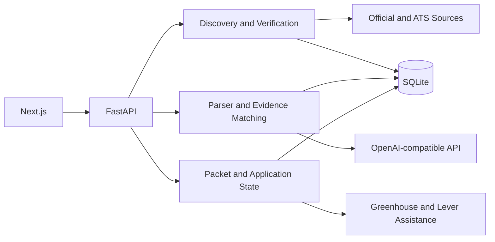
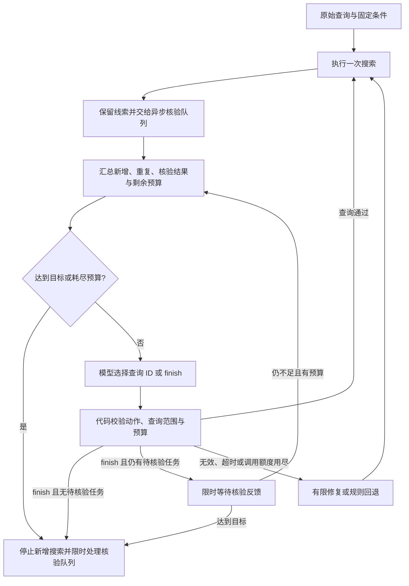

# JobFlow Agent

面向国内校招与实习场景的证据约束求职系统，采用确定性工作流与局部 Agent 结合的架构。
搜索环节可启用根据结果反馈选择下一条查询的有边界 Agent；模型负责 JD 解析、
可选的普通能力语义匹配与材料建议。来源验证、资格规则、执行预算、用户审批、状态转换和
最终提交由可测试的确定性代码控制。

> 当前版本：`v0.4 Assisted Apply`。支持 SQLite 单机本地运行；不承诺公网多用户
> 托管、任意 ATS 兼容、无人值守批量投递或绕过登录与反自动化控制。


## 核心能力

### 1. 岗位搜索、核验与筛选

- 先持久化来源白名单、工具顺序、调用预算和停止条件，再执行搜索；
- 已适配来源优先使用官方 Adapter，失败后按计划回退；
- 搜索支持 `rule` / `agent` 模式：Agent 根据新增链接、重复率与核验反馈选择后续查询；
- 搜索摘要和第三方线索只能创建待验证 `JobLead`，不能直接成为可信岗位；
- 统一执行 URL 安全检查、正文验证、标准化、去重和岗位开放状态审计；
- 默认搜索不调用完整 JD 解析或简历匹配。地点、招聘类型等由本地筛选；正文方向以具体职责为主，可对完整正文进行限时模型复核，必须绑定原文职责引用；
- 本地筛选地点、招聘类型、方向、关键词及明确的适用届别，展示已识别条件和逐项来源依据；
- 对已限定到当前岗位的正文，识别标题与职责之间独立的地点字段，以及“2027届校园招聘计划”等明确届别；带地域、毕业日期或冲突年份的表述仍保留待核实。旧结果刷新时也会从保存原文补取缺失地点，不重复联网或调用模型；
- 结果先按“符合已知条件、待核实、明确不符”排列，再在每类内部按公司分组；已通过的公司组默认展开，招聘入口单列在岗位之后；
- 结果分为“符合已知条件 / 待核实 / 明确不符”，仅明确冲突默认收起，缺少原文不等于不符合；
- 两个核验任务并发运行；预算用尽的链接保留为可重试的 `DEFERRED`，不要求用户补贴 JD；
- 招聘类型取岗位明确字段、标题或头部信息；导航、页脚与推荐岗位不作为当前岗位事实。列表页自动展开寻找详情链接，不计作具体岗位；
- 页面只剩“该职位已下线”时，保存原文、来源 URL 和快照引用为 `CLOSED` 线索，默认隐藏，不补造 JD。超大浏览器页面可移除脚本、样式等负载后核验，仍限制 DOM 和可见文本大小；
- 复杂学历、专业、日期范围及额外条件保留待核实，完整资格与能力匹配由用户按需启动；
- 每次运行保留 Plan、Act、Observe、Fallback 与 Stop 轨迹。

### 2. 证据约束的 JD 解析与匹配

- 在岗位详情中按需启动分析，使用 Product Parser；默认先抽取事实和原文条款，再解释条件关系，可配置单次调用；
- 两阶段第一阶段成功后保存检查点，第二阶段失败后的再次分析可以直接恢复关系判断；
- 以 Pydantic Schema、字段级原文证据和一致性检查约束模型输出；
- 匹配结论必须引用当前用户的经历证据 ID，并校验归属与事实一致性；
- 普通能力默认本地匹配；显式启用语义模式后按岗位批量调用，模型引用句子编号，本地回填和校验原句；
- 缺少证据或匹配失败保留为信息不足，不等同于候选人明确不符合；
- 个人届别、学历和专业按类型化规则判断；搜索列表的筛选分类独立于简历匹配结论。

配置、缓存及失败处理见 [JD 执行模式](docs/PRODUCT_JD_EXECUTION_MODES.md) 和
[候选人事实与匹配](docs/CANDIDATE_FACTS_AND_MATCHING.md)。

### 3. 可审核的申请流程

- 简历、答案与投递包使用不可变版本，审批后不允许原地修改；
- Application、Packet、Attempt、Receipt 和 Follow-up 分别记录业务状态；
- 敏感字段需要用户明确确认，ATS 提交授权一次有效且绑定具体任务；
- 遇到登录、CAPTCHA、2FA、页面变化或无法确认的字段时暂停并请求接管；
- 只有校验到有效回执后，Application 才能进入 `SUBMITTED`。

## 工作流

```text
求职目标
  -> 来源白名单与 Search Plan
  -> 官方来源 / ATS Adapter / 受控页面读取
  -> JobLead 验证、标准化与去重
  -> 本地按搜索条件筛选，结果陆续显示
  -> 查看 / 保存 / 忽略岗位
  -> 可选：Product JD Parser + 资格规则 + 经历证据匹配
  -> 用户选择并创建 Application
  -> 材料审批与投递包冻结
  -> 人工操作或有限 ATS 辅助
  -> 有效 Receipt
  -> SUBMITTED 与后续跟进
```

职责边界：

| 参与方 | 负责内容 |
| --- | --- |
| 模型 / 局部 Agent | 搜索模式启用后根据反馈选择下一条查询；解析 JD、可选语义匹配、生成材料建议 |
| 确定性代码 | Schema 校验、资格规则、URL 安全、预算、状态机、授权与凭证 |
| 用户 | 确认敏感事实、审批材料、决定是否申请和提交 |

## 架构



后端采用模块化单体结构，通过 `api / domain / services / infrastructure` 保持边界；
SQLite 是当前唯一支持的业务数据库。前端以工作区形式覆盖岗位发现、材料库、投递包、
投递尝试、ATS 辅助与后续跟进。

## 评测结果

| 评测 | 数据范围 | 结果 | 适用边界 |
| --- | --- | ---: | --- |
| Staged JD Parser | 基于公开招聘页面构建的 39 条严格子集（规则标签 + 人工覆盖） | Macro-F1 `0.9897` | 仅岗位类型、地点和必备技能三个字段 |
| Core JD Parser v28 | 冻结 dev-21，五字段 | Macro-F1 `0.9549` | 真实 DeepSeek 输出经 v28 确定性归一化重放；开发集，不是最终 holdout |
| Discovery Agent | 13 个离线控制面 Fixture | `13/13` | 来源授权、路由、回退、预算与轨迹 |
| Trusted Discovery | 9 个离线确定性 Fixture | `9/9` | 正文验证、去重、开放状态与人工接管 |
| Assisted Apply | 14 个 Greenhouse/Lever Mock ATS 场景 | `14/14` | 字段映射、接管、授权与提交凭证 |
| 浏览器回归 | Chromium 桌面端与移动端 | `20/20` | 关键本地用户流程 |

Parser 的 39 条岗位原文因来源授权边界未提交到仓库，公开内容包括评测代码、标签覆盖、
指标定义和聚合结果，因此该结果不是可从仓库独立还原原始数据的公共 Benchmark。
Fixture 通过率也不代表真实官网召回率、真实 ATS 兼容率或线上投递成功率。

另有一份 [165 条 AI 校招与实习岗位元数据目录](datasets/AI_CAMPUS_DATASET_2026_08_31.md)，
覆盖 25 家公司；其中 154 条已完成人工字段覆盖。当前已在固定的 21 条开发集上完成
真实模型输出评测；密封 holdout 仍未运行。dev-21 结果用于冻结实现和调试，不能当作
最终测试集成绩。版本与复现实验边界见
[v28 dev-21 冻结说明](datasets/AI_CAMPUS_CORE_V28_DEV21_FREEZE_2026_09_02.md)。

详细口径与机器可读结果：

- [JD Parser 评测](docs/EVALUATION.md)
- [Discovery Agent 控制面评测](docs/DISCOVERY_AGENT_EVALUATION.md)
- [可信岗位发现评测](docs/TRUSTED_DISCOVERY_EVALUATION.md)
- [Assisted Apply 评测](docs/evaluation/m19-assisted-apply-summary.md)

## 快速开始

环境要求：

- Python 3.12；
- [uv](https://docs.astral.sh/uv/)；
- Node.js 22 与 npm；
- Windows PowerShell，或分别启动前后端。

默认配置使用 Fake Model Provider，不需要 API Key 即可运行本地界面和测试。

### Windows 一键启动

```powershell
Copy-Item .env.example .env
powershell -ExecutionPolicy Bypass -File scripts/start-dev.ps1
```

打开 `http://localhost:3000`。后端默认运行在 `http://127.0.0.1:18001`。

### 可选：浏览器能力

基础界面和 Fake Model 演示不依赖浏览器组件。使用动态岗位页面读取或 ATS
浏览器辅助时，在项目根目录安装 Python Playwright 对应的 Chromium：

```powershell
uv run playwright install chromium
```

运行前端 Playwright E2E 时，另行安装 Node.js Playwright 对应的 Chromium：

```powershell
Set-Location frontend
npx playwright install chromium
```

### 分别启动

后端：

```powershell
Copy-Item .env.example .env
uv sync --frozen
uv run alembic upgrade head
uv run uvicorn src.main:app --reload --host 127.0.0.1 --port 18001
```

前端：

```powershell
Set-Location frontend
Copy-Item .env.example .env.local
npm ci
npm run dev
```

接入 OpenAI-compatible 模型时，在 `.env` 中配置：

```dotenv
STRUCTURED_MODEL_PROVIDER=openai_compatible
LLM_BASE_URL=https://your-provider.example/v1
LLM_API_KEY=your-api-key
LLM_MODEL=your-model
```

服务商支持 Responses 内置 `web_search` 时，设置 `WEB_SEARCH_PROVIDER=responses`。
搜索复用上述模型配置，请求 `/responses`，无需 Tavily 密钥。该模式将原始条件、方向与城市、公司官网和同义岗位拆成独立查询；重复或空结果会优先切换查询策略。
默认最多 6 条查询、搜索预算 300 秒；搜索生产队列与正文核验消费队列独立推进，搜索结束后最多继续核验 180 秒，每个页面任务最多 60 秒。
配置项为 `WEB_SEARCH_MAX_ROUNDS`、`WEB_SEARCH_BUDGET_SECONDS`、`WEB_SEARCH_VERIFICATION_BUDGET_SECONDS`、`WEB_SEARCH_VERIFICATION_ITEM_SECONDS`；有效候选目标由 `WEB_SEARCH_TARGET_JOBS` 控制。单次搜索独立限制为 60 秒（`WEB_SEARCH_REQUEST_TIMEOUT_SECONDS`），连接超时及 408/429/500/502/503/504/524 等临时故障在整次搜索内最多重试 1 次（`WEB_SEARCH_TRANSIENT_RETRIES`）；每次重试均消耗一个搜索轮次，401/403 等认证或访问错误停止新增搜索，总预算耗尽则取消请求。单请求超时不会被误当成整次搜索预算耗尽；失败、无具体岗位或核验无有效结果时，规则补搜优先尝试保留原始条件的跨公司查询或同义方向。
招聘入口默认最多展开 8 个，每个最多 6 页、接收 20 条具体链接（`WEB_SEARCH_ENTRY_LIMIT`、`WEB_SEARCH_ENTRY_MAX_PAGES`、`WEB_SEARCH_ENTRY_MAX_DETAILS`）。先按查询相关性排序，再在入队和创建线索前执行限额；跨页共享限额，未接收的已读链接仍保留在页面快照，数量记入轨迹，不视为已判定不符。未确认官网归属的聚合入口保留一条待补搜线索，不批量展开或直接要求用户接管。支持观察到的列表链接、下一页链接及明确的下一页/加载更多按钮；登录、验证码和申请操作不会自动执行。
搜索结果先合并链接元数据，再把论坛帖子、附件、新闻文章和无关参考来源留在搜索证据中，不作为岗位候选；标题明确指向其他届别的招聘公告也不进入本届候选。缺失届别或 URL 中含旧年份不作为排除依据。相同岗位的跟踪参数变体合并，保留原始响应和链接，保留 `#/job/...` 等 SPA 路由及岗位、项目、企业标识。
Responses 每次请求只要求一次小范围检索、最多 5 条简短结果，输出预算为 1200 tokens；这是请求目标，不保证服务商只执行一次工具调用。完整返回的 sources 仍保留并解析。规则补搜在跨公司条件查询、同义方向和具体公司范围之间切换，避免连续执行语义近似的宽查询或只沿固定公司列表搜索。

支持的企业 ATS 链接可自动追溯注册公司官网。公司名称只用于选择待检查官网，必须实际读取到官网出链才确认归属，并保存页面快照和企业范围；不能把共享 ATS 域名整体视为某公司的官网。追溯在单次搜索内缓存，每家公司最多读取 3 页、25 秒，总计最多 4 家；失败时保留待核实状态。

方向复核仅发送查询和公开岗位正文，不读取简历。每次搜索最多 12 次、每次最多 15 秒、不自动重试，计入现有核验预算；已有明确地点等冲突或正文不完整时跳过。复核只影响岗位方向，不能覆盖地点、届别等其他条件；非法引用或模型超时不产生排除结论。结果按用户、查询、正文和版本绑定保存，刷新复用，正文或查询变化时失效。可用 `WEB_SEARCH_ROLE_REVIEW_ENABLED=false` 关闭。
方向范围由用户限定：普通后端查询包含平台核心模块、数据服务、资源调度和分布式系统研发，不限业务 CRUD；纯部署运维或模型训练本身不足以通过。用户明确排除基础设施时仍遵守该限制。方向策略升级会使旧版本复核缓存失效，避免继续沿用已修正的排除结论。

动态官网可为每家公司配置已观察到的精确 `resource_hosts`，这些只用于页面资源加载，不建立企业归属。小米的 `jobs.f.mioffice.cn` 与飞书等 ATS 一样，仍须官网出链才能获得企业范围内的信任。
搜索历史展示每条查询、实际查询（服务商有返回时）、新增/重复链接、具体岗位数、耗时及失败原因。完整响应与查询证据保存在 `search_evidence`，通过有用户权限校验的 `GET /api/discovery/runs/{run_id}/search-evidence` 获取，并纳入账户导出/删除。
响应即使未整体完成，只要有已完成的真实联网搜索记录，仍保留可用链接与来源并标记部分结果。摘要不会变成已核验 JD；原始正文核验成功后才进入 JD 解析。兼容网关明确不支持 sources include 参数时只重试一次，并保留拒绝响应。
搜索与核验预算不含随后最多 5 条 JD 分析。达到预算后保留已有线索，不保证岗位数量或全网覆盖。

### 可选：搜索 Agent 决策

默认 `WEB_SEARCH_DECISION_MODE=rule` 保留现有策略。配置好上述真实结构化模型后，
在 `.env` 中启用并重启后端：

```dotenv
WEB_SEARCH_DECISION_MODE=agent
WEB_SEARCH_DECISION_MAX_CALLS=6
WEB_SEARCH_DECISION_TIMEOUT_SECONDS=12
```

决策模式与搜索服务分开配置：Agent 可使用 Responses、Tavily 或 Bing RSS 执行搜索；
模型决策复用 `STRUCTURED_MODEL_PROVIDER` 和 `LLM_*` 配置。默认 Fake Provider
不模拟搜索决策，启用 Agent 但仍使用 Fake Provider 时会因输出不符合契约而回退规则。



第一轮始终使用原始查询。后续轮次提供候选查询 ID、历史查询、新增与重复链接数、
正文核验失败类型、已核验岗位摘要和剩余预算；排队及正在核验的任务单独计数，
不会当作“没有找到岗位”。

第一版允许 `search_web(query_id)` 和 `finish`。候选查询由代码生成，完整保留原始
用户条件，仅追加已登记公司官网范围或已知岗位关键词。模型只能选 ID，不能自由重写
城市、届别、公司范围或输出任意 URL。招聘入口展开仍由现有工作流控制。

每次决策最多修复一次，修复也计入总调用上限；模型请求不自动重试网络错误。
决策与修复共用一次决策的时间额度，最多使用当时剩余搜索时间的一半，并受整个搜索
时间预算约束。模型失败、动作非法或决策调用耗尽时，使用规则选择尚未执行的查询。
`finish` 遇到待核验任务时，先触发一次核验检查：等待不超过 15 秒、单项核验时限和
剩余搜索时间的一半。达标则停止新增搜索；仍不足则提供最新反馈并要求选择新的查询，
再次结束的建议会被拒绝并进入有限修复或规则回退。检查本身不占搜索轮次，等待时间计入
搜索总预算。模型等待期间已达到岗位目标时，工作流会丢弃过时的搜索建议。
全部搜索结束后，未完成线索仍按原核验预算处理。

`agent_trace` 保存观察输入、模型建议、校验错误、选中的查询、简短理由、耗时和
服务商返回的 token 用量；实际执行的查询另存 `search_evidence`。离线测试覆盖选择、
回退、预算、取消与队列处理，尚未测量该模式相较规则策略的真实岗位召回、耗时或成本收益。

真实小规模试跑可使用下列脚本。两个模式都使用同一套保留原始条件的候选查询、相同的
搜索与核验预算，以及最多一秒的核验反馈等待；分别创建新的 SQLite 数据库，默认不执行
后续 JD 分析。目录必须尚不存在，原始响应保存在数据库，指标与轨迹保存在 `report.json`。

```powershell
uv run python -m scripts.run_search_decision_probe --mode agent --output-dir artifacts/search-probe/agent
uv run python -m scripts.run_search_decision_probe --mode rule --output-dir artifacts/search-probe/rule
```

可用 `--query` 指定需求。单次顺序运行只用于诊断，搜索结果会随时间变化；工作流中的
有效岗位数是现有匹配规则的统计，不能替代对届别、方向和开放状态的逐项核实。

`.env`、本地数据库、私密材料和评测原始输出均已排除在版本控制之外。

## 验证

真实官网与无 API Mock 的前后端验收见 [2026-09-17 验收报告与复跑说明](docs/DISCOVERY_ACCEPTANCE_2026_09_17.md)。

```powershell
uv run alembic upgrade head
uv run pytest -q
uv run ruff check .

Set-Location frontend
npm run typecheck
npm run build
npm run test:e2e
```

GitHub Actions 会从空 SQLite 文件执行迁移，并运行后端测试、Ruff、前端类型检查、
生产构建和 Playwright 桌面/移动端回归。

## 项目结构

```text
src/
  api/             FastAPI 路由与请求契约
  domain/          状态机、实体与领域规则
  services/        发现、解析、匹配、材料和投递流程
  infrastructure/  SQLite 与模型客户端
  evaluation/      可重复评测入口和指标
frontend/          Next.js 工作区与 Playwright E2E
migrations/        Alembic SQLite 迁移
datasets/           版本化 Fixture、Manifest 与标签覆盖
docs/               架构、评测和完整技术参考
tests/              后端单元、服务与端到端测试
```

## 安全与范围

- 招聘网页始终按不可信输入处理，页面文字不能覆盖系统约束；
- 网络读取限制协议、主机、重定向、响应大小、超时和重试预算；
- 私密简历保存在非静态目录，日志对密钥、令牌、邮箱和手机号脱敏；
- 本地 `AUTH_MODE=local` 仅用于开发，staging/production 会进行 fail-closed 配置检查；
- 系统不绕过登录、CAPTCHA、Cloudflare、2FA 或其他反自动化控制；
- 无人值守批量投递、任意 ATS 和公网多租户部署不在 `v0.4` 范围内。

## 延伸阅读

- [完整技术参考](docs/TECHNICAL_REFERENCE.md)
- [开发流程与模块边界](docs/DEVELOPMENT_WORKFLOW.md)
- [里程碑与实现记录](docs/IMPLEMENTATION_HISTORY.md)
- [真实模型验收说明](docs/REAL_MODEL_ACCEPTANCE.md)
- [JD 阶段恢复、单次调用模式及对照结果](docs/PRODUCT_JD_EXECUTION_MODES.md)
- [安全策略](SECURITY.md)
- [CI 发布门禁](.github/workflows/ci.yml)

## License

本项目采用 [MIT License](LICENSE)。
